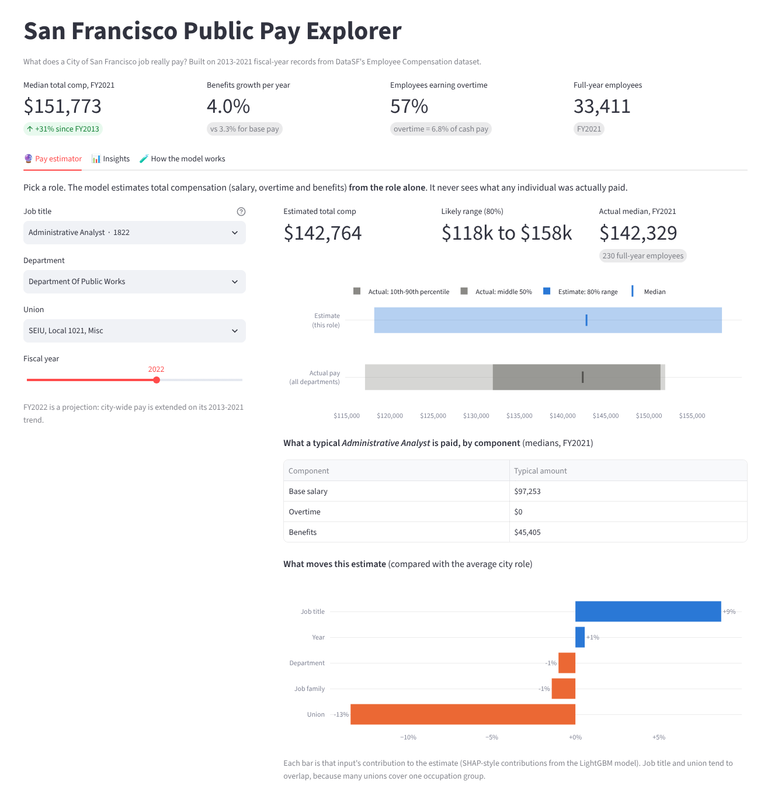
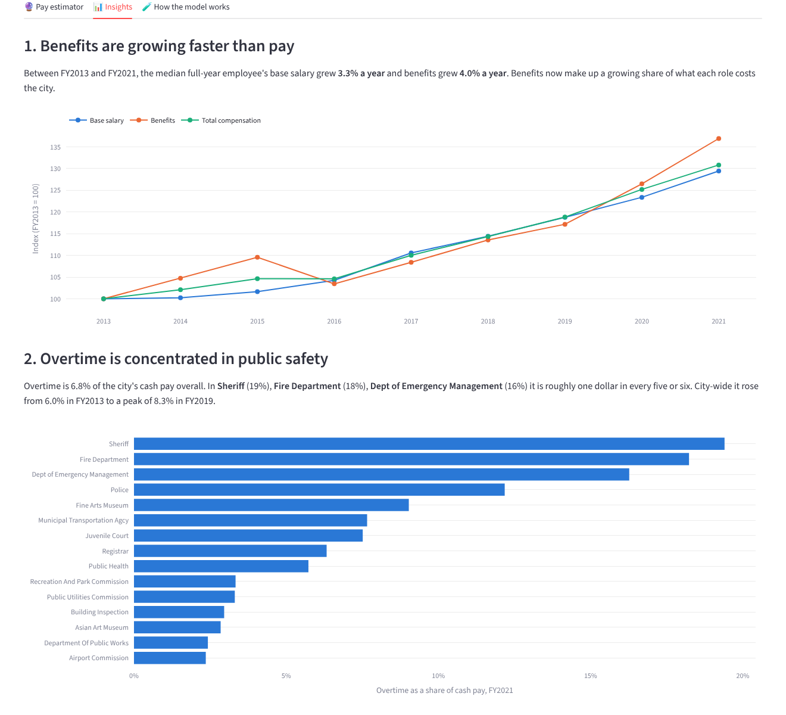

# San Francisco Public Pay Explorer

**What does a City of San Francisco job really pay?** This project cleans 10 years of public pay records. It finds what drives pay across 60 departments and 1,200+ job titles. It also estimates what any role pays, with a range you can trust.

**[Open the live app](https://mk-san-fran-staff-compensation.streamlit.app/)** · [Walkthrough notebook](notebooks/analysis.ipynb) · Data: [DataSF Employee Compensation](https://data.sfgov.org/d/88g8-5mnd)



## Key findings

Figures cover full-year employees in fiscal years 2013 to 2021.

1. **Pay is set by the job, not the department.** The same job title pays almost the same everywhere. Across 45 jobs held in two or more departments, the typical gap is just 2.7%.
2. **The role explains about 78% of pay.** The rest is individual. It comes from overtime hours, seniority steps and time on leave.
3. **Benefits are growing faster than salaries.** Median base salary grew 3.3% a year. Median benefits grew 4.0% a year.
4. **Overtime is concentrated in public safety.** It is 6.8% of cash pay city-wide. In the Sheriff's Office and the Fire Department it is 18% to 19%.
5. **The source data has a gap.** In this export, health and dental is $0 for 93% of FY2022 records. Taken at face value FY2022 looks like a pay cut. The pipeline detects incomplete years and leaves them out.



## The model

**Question:** given only a role (job title, job family, department, organisation group, union and year), what total compensation should you expect?

The six pay components add up exactly to total compensation. So none of them are model inputs. The model only sees what you know about a role before anyone is paid.

**Design**

- **Tested on the future.** Trained on FY2013 to FY2020. Tested on FY2021, a year it never saw.
- **Pay level and pay structure are split.** A city-wide pay index carries inflation and pay rises. LightGBM learns each role's pay relative to that index. This lets the model project forward, which tree models can't do on their own.
- **Ranges, not just a number.** Quantile models give an 80% range. The range is calibrated on FY2020 so it really covers about 80% of people.
- **Compared with baselines.** The model is measured against the city-wide median and against last year's median for each job title.

**Results on FY2021**

| Approach | R² | Mean abs. error | Median abs. % error | 80% range covers |
|---|---|---|---|---|
| City-wide median | -0.06 | $50,340 | 25.9% | n/a |
| Job title median (last year, grown) | 0.781 | $19,945 | 7.7% | n/a |
| **LightGBM (this model)** | **0.778** | **$19,816** | **7.7%** | **83%** |

A job title lookup matches the model on point accuracy. That tells us San Francisco pays by job classification. The model adds a calibrated range and estimates for any job, department and union combination. It also shows what drives each estimate.

## How the data is cleaned

- **Fiscal years only.** The raw export lists every employee twice a year, once by calendar year and once by fiscal year.
- **Codes, not names.** Departments and jobs were renamed over time ("DPH Public Health" became "Public Health"). Each code gets its latest name. This turns 108 department names into 60 real departments.
- **Real zeros stay zero.** Most employees earn no overtime. That is information, not missing data.
- **Part-year records are flagged, not deleted.** A record is "full year" when base salary is at least half the job's median that year and at least $15k.

## Project structure

```
├── streamlit_app.py          # the app
├── src/
│   ├── clean.py              # raw CSV -> data/processed/compensation.parquet
│   ├── train.py              # model, evaluation, reports
│   └── insights.py           # summary tables for the app
├── notebooks/analysis.ipynb  # walkthrough of the whole project
├── models/                   # LightGBM models (p10, p50, p90) + metadata.json
├── reports/                  # model comparison, feature importance, error by job family
├── app_data/                 # small CSVs the app reads (under 1 MB)
└── docs/                     # screenshots
```

## Run it yourself

```bash
pip install -r requirements-dev.txt

# 1. Download the data from DataSF and save it as data/Employee_Compensation.csv
#    https://data.sfgov.org/api/views/88g8-5mnd/rows.csv?accessType=DOWNLOAD

# 2. Build everything (about 5 minutes)
python -m src.clean
python -m src.train
python -m src.insights

# 3. Launch the app
streamlit run streamlit_app.py
```

The app only needs `models/`, `reports/` and `app_data/`. These are committed, so it deploys without the raw data. To refresh with newer years, download a new export and rerun the three scripts.

## Limitations

- The data has no hours worked. "Full year" is a proxy based on base salary.
- Estimates are for a role, not a person. Seniority and individual history are out of scope by design.
- Projections assume the historical pay trend continues.

## Next steps

- Refresh with the latest DataSF export. It now runs to FY2026.
- Model overtime on its own. It is the biggest source of individual variation.
- Compare SF public pay with private-sector pay for similar occupations.

## Tech

Python · pandas · LightGBM · Streamlit · Plotly · matplotlib

---

Built by [Mary Kinya](https://marykinya.com), Analytics Engineer.
